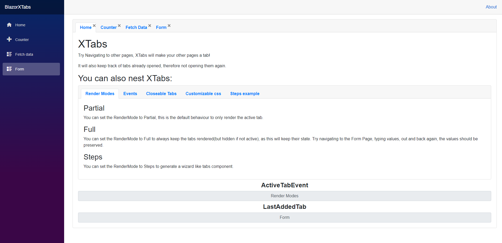

# BlazorXTabs
An extended tabs component library providing various tab features for Blazor!


[](https://www.nuget.org/profiles/DavidMoreira)

[](LICENSE)



Checkout all the examples at: [BlazorXTabs Demo](https://david-moreira.github.io/BlazorXTabs/)

## Main Features:
- Close tabs
- Navigate to page and render it as a tab
- Tabs won't duplicate when navigating to the same page
- Use XTabs classes to further customize the look
- Keep tabs state when switching between tabs
- Bind to events: Selected / Changed / Removed
- **v1.2.0**
  - Setup wizard like tabs with events: Previous / Next and customizable previous/next buttons
  - Possibility to set the active tab to Loading
- **v1.3.0**
  - Able to drag & drop tabs
- **v1.4.0**
  - Able to replace the standard RouteView component with a XTabsRouteView component that automatically renders the pages as tabs
- **v1.5.0**
  - When CloseTabs is enabled. Able to close all tabs and configure a threshold to display the close all tabs button.
  - When CloseTabs is enabled. Able to use mouse middle button click to close the tab.
  - When CloseTabs is enabled. Able to limit closeable tabs to 1.
- **v1.6.0**
  - Fixed RenderMode.Partial duplicating tabs
  - Introduced XTabsAuthorizeRouteView to allow tabs integration with Authentication
- **v1.7.0**
  - NET6 Support
- **v1.8.0**
  - NET7 Support
- **v1.9.0**
  - Introduced NavigationMode, this is a XTabsRouteView only setting.
    - NavigationMode.Standard : This is the default and XTabs will work as it always did. Clicking a Page Tab will set it as active.
    - NavigationMode.Navigable : This new setting will make it so that whenever a Page Tab is set to active, it additionally triggers navigation. 
      This is usefull to sync the browser url to the currently active Page Tab.
- **v2.0.0**
  - NET8 Support
- **v3.0.0**
  - NET9 Support
- **v3.0.1**
  - Fix SetTitle Method to properly set the title without overriding inherent id and automatically refresh tabs
- **v4.0.0**
    - Drop support for .NET6 and .NET7
    - NET10 Support
- **v4.0.1**
    - Fixed default css for close button hiding in bootstrap 5
- **v5.0.0**
    - Drop support for .NET8 and .NET9
    - NET11 Support
    - **Breaking:** XTabs styles are no longer shipped as scoped CSS (`{YOUR-PROJECT-NAME}.styles.css`). They now live in a standalone stylesheet, `_content/BlazorXTabs/blazorxtabs.css`, that you reference explicitly (or leave out to use your own styles)
    - Styles are customizable through `--xtabs-*` CSS variables
    - Optional Bootstrap 5 theme, `_content/BlazorXTabs/blazorxtabs.bootstrap.css`, that follows Bootstrap's light/dark color modes
    
## Examples:

#### Standard usage:
    <XTabs>
        <XTab Title="Tab1">
            Content 1
        </XTab>
        <XTab Title="Tab2">
            Content 2
        </XTab>
    </XTabs>

#### Using the XTabsRouteView or XTabsAuthorizeRouteView to render pages as tabs:
    <Router AppAssembly="@typeof(Program).Assembly">
        <Found Context="routeData">
            <XTabsRouteView CloseTabs="true" NewTabSetActive="true" 
            NavigationMode="BlazorXTabs.Configuration.NavigationMode.Navigable"
            RenderMode="BlazorXTabs.Configuration.RenderMode.Full" 
            RouteData="@routeData" DefaultLayout="@typeof(MainLayout)" />
        </Found>
        <NotFound>
            <LayoutView Layout="@typeof(MainLayout)">
                <p>Sorry, there's nothing at this address.</p>
            </LayoutView>
        </NotFound>
    </Router>
##### Use the XTabPageAttribute to set the page's tab title & other relevant parameters
     @attribute [XTabPageAttribute("Home")]

#### Using as a wizard:
        <XTab Title="Steps example">
            <XTabs RenderMode="BlazorXTabs.Configuration.RenderMode.Steps">
                <XTab Title="Step1">
                       This is step 1!
                </XTab>
                <XTab Title="Step2">
                    This is step 2!
                </XTab>
                <XTab Title="Step3">
                    This is the last step. Step 3!
                </XTab>
            </XTabs>
        </XTab>
#### Drag&Drop:
        <XTab Title="Drag Example">
            <XTabs IsDraggable="true" RenderMode="BlazorXTabs.Configuration.RenderMode.Partial" >
                    <XTab Title="1. I can be dragged!!">
                        <p>I can be dragged!!</p>
                    </XTab>
                    <XTab Title="2. Drag me!">
                        <p>Drag me!</p>
                    </XTab>
                    <XTab Title="3. Please drag me!! I hate being last place!">
                        <p>Please drag me!! I hate being last place!</p>
                    </XTab>
            </XTabs>
        </XTab>
## Setup: 
- You can install the package via the nuget package manager just search for *BlazorXTabs*. You can also install via powershell using the following command.

```powershell
Install-Package BlazorXTabs
```

- Or via the dotnet CLI.

```bash
dotnet add package BlazorXTabs
```

- If you'd like to bring in XTabs default styling, add the stylesheet to your `App.razor` / `index.html` / `_Host.cshtml`:
```html
<link href="_content/BlazorXTabs/blazorxtabs.css" rel="stylesheet" />
```
or, with static asset fingerprinting:
```razor
<link href="@Assets["_content/BlazorXTabs/blazorxtabs.css"]" rel="stylesheet" />
```

- Optionally, add the Bootstrap 5 theme after it so XTabs follows Bootstrap's colors and light/dark mode:
```html
<link href="_content/BlazorXTabs/blazorxtabs.bootstrap.css" rel="stylesheet" />
```

- Customize the look by overriding the CSS variables, for example:
```css
:root {
    --xtabs-bg: transparent;
    --xtabs-link-active-bg: var(--bs-secondary);
}
```
Available variables: `--xtabs-bg`, `--xtabs-border-color`, `--xtabs-border-radius`, `--xtabs-header-bg`, `--xtabs-header-padding`, `--xtabs-content-padding`, `--xtabs-link-color`, `--xtabs-link-padding`, `--xtabs-link-active-bg`, `--xtabs-link-active-border-color`, `--xtabs-drop-border`, `--xtabs-close-color`, `--xtabs-close-text-shadow`, `--xtabs-close-opacity`, `--xtabs-close-all-color`.

- Don't want the default styling at all? Just don't reference the stylesheet and style the `xtabs-*` classes yourself.

#### Upgrading from v4
XTabs styles used to come in through `{YOUR-PROJECT-NAME}.styles.css`. From v5 you must add `<link href="_content/BlazorXTabs/blazorxtabs.css" rel="stylesheet" />` to keep the default look.
